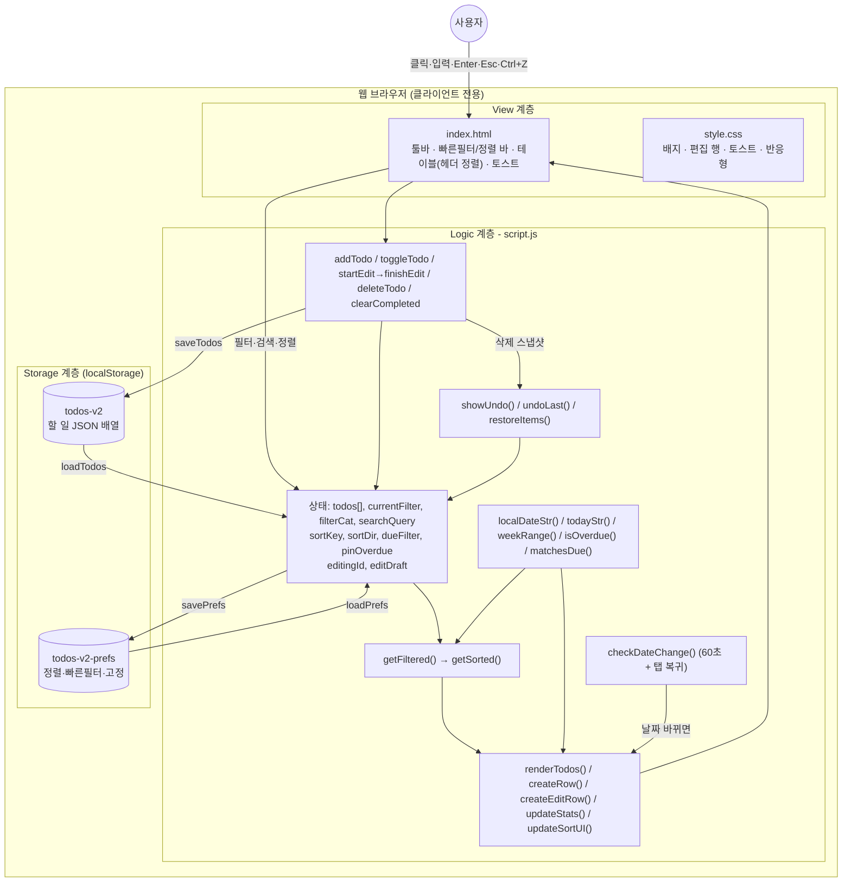
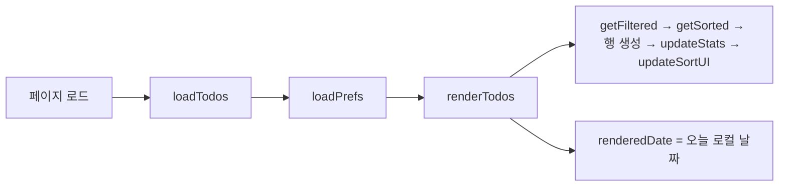
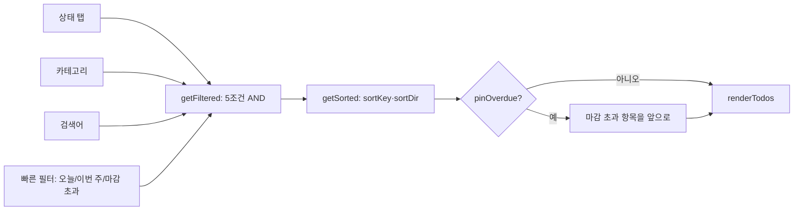
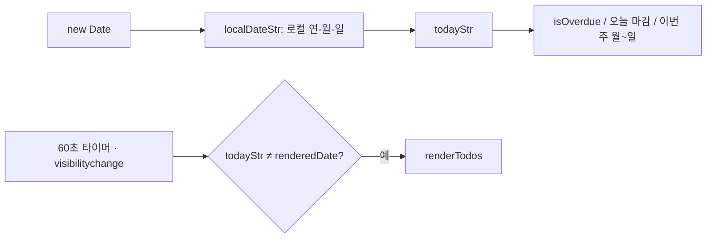
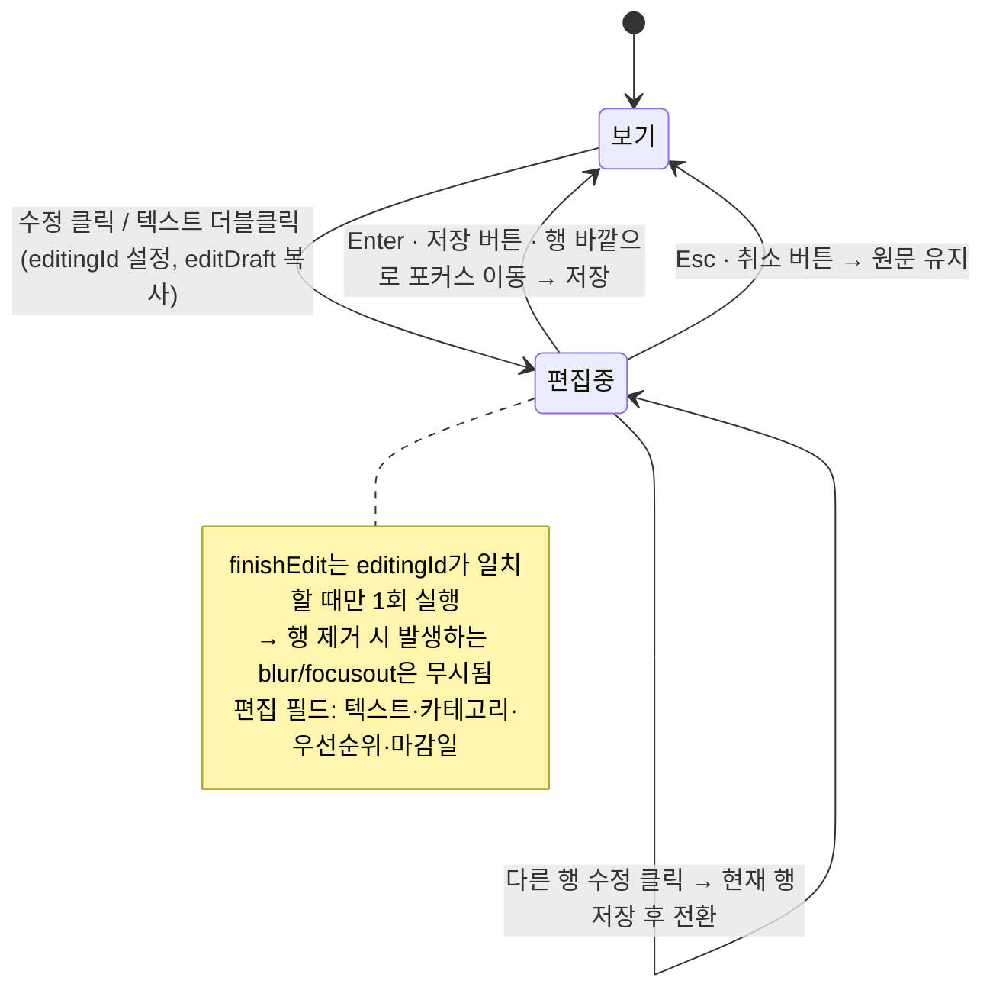
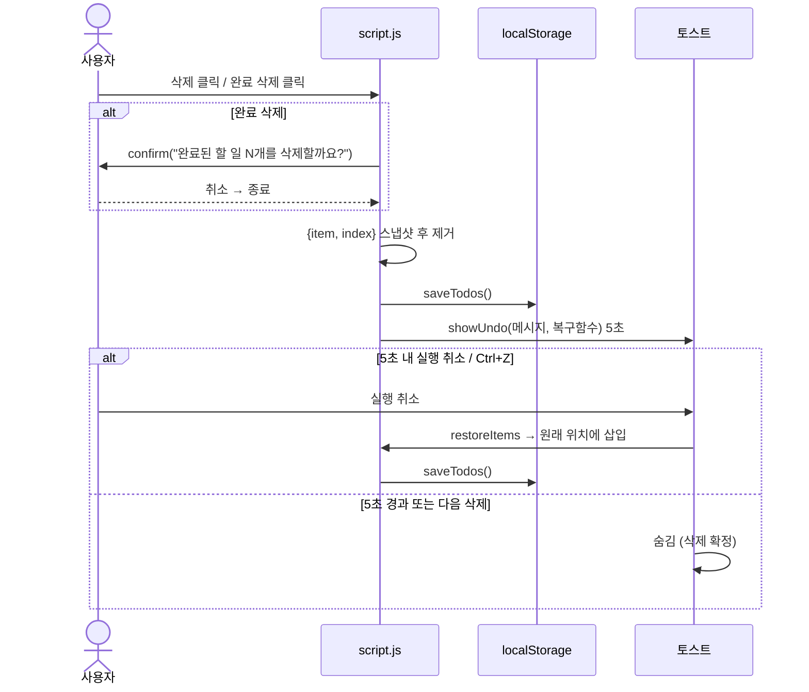

# 아키텍처 구성도 및 흐름도 (v1.1)

> 출처: #1 (v1.0 분석) → v1.1 고도화(#2 #3 #4 #5) 반영본. 계획·검증 이력은 `docs/pdca/v1.1/` 참조.

## 개요

순수 HTML/CSS/JS 기반 클라이언트 전용 할 일 관리 앱입니다. 서버·회원 기능이 없고 데이터는 브라우저 `localStorage`에 저장합니다.

| 파일 | 역할 |
|------|------|
| `index.html` | 사이드바, 상단 바, 요약 카드, 툴바(검색·상태·카테고리), 빠른필터·정렬 바, 추가 폼, 테이블, Undo 토스트 |
| `script.js` | 상태, 저장, 날짜 유틸, 필터·정렬, 렌더링, CRUD, 편집 행, Undo |
| `style.css` | 레이아웃, 배지, 진행 바, 마감 초과/오늘 마감 표시, 편집 행, 토스트, 반응형 |
| 배포 | GitHub Pages (master `/`) → https://2hanok.github.io/todo-app/ |

## 1. 전체 아키텍처



### 데이터 모델 (`todos-v2`, v1.0과 동일 — 마이그레이션 없음)

```json
{ "id": 1751234567890, "text": "보고서 작성", "category": "업무|개인|공부", "priority": "긴급|보통|낮음", "dueDate": "YYYY-MM-DD", "completed": false, "createdAt": "ISO8601" }
```

### 설정 모델 (`todos-v2-prefs`, v1.1 신규)

```json
{ "sortKey": "created|due|priority|text", "sortDir": "asc|desc", "dueFilter": "|today|week|overdue", "pinOverdue": false }
```

## 2. 흐름도

### 2-1. 앱 초기화



### 2-2. 필터·정렬 파이프라인 (#2)



- 정렬 기준: 등록순(`createdAt`) / 마감일 임박순(마감일 없음은 항상 맨 뒤) / 우선순위순(긴급→보통→낮음, 동률은 마감일) / 이름순
- 헤더(할 일·우선순위·마감일) 클릭: 같은 열 재클릭 시 방향 전환, ▲▼ 표시

### 2-3. 날짜 처리 (#3)



### 2-4. 편집 (#4)



### 2-5. 삭제와 실행 취소 (#5)



## 3. 변경 이력

| 버전 | 내용 |
|------|------|
| v1.0 | 초기 구현 (CRUD, 카테고리, 우선순위, 마감일, 검색, 상태 필터, 요약 카드) |
| v1.1 | #3 로컬 날짜·자정 갱신 / #4 Esc 취소 보장·전 필드 편집 / #2 정렬·헤더 정렬·빠른필터·마감초과 고정·설정 저장 / #5 Undo 토스트·완료 삭제 확인 / 추가 폼 숨김 버그 수정 / 모바일 레이아웃 보정 |

## 4. 남은 과제

- 휴지통(소프트 삭제, 30일 보관): #6 보류
- 사이드바 통계·설정 메뉴: "준비 중"
- 전체 재렌더링(`tbody.innerHTML = ''`) 방식 유지 — 하루 10~20건 규모에서는 성능 문제 없음
